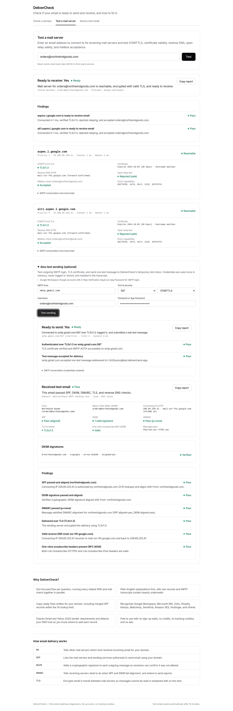
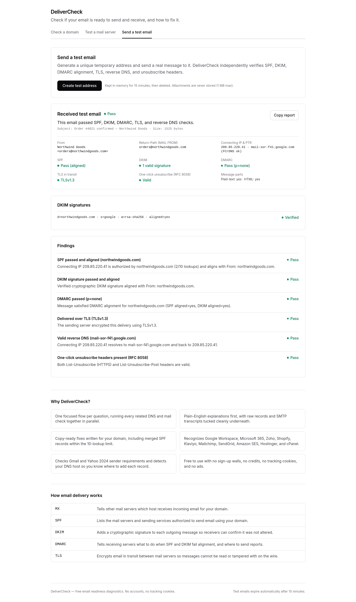

# DeliverCheck

DeliverCheck answers one question for a store or business domain: is your email ready to send and receive, and how do you fix what is broken? It inspects your domain's DNS records, tests live receiving and outgoing mail servers, and analyzes a real test email in plain English with copy-ready fixes.

## Screenshots

### Check a domain


### Test a mail server (receiving and optional sending)



### Send a test email



## Why DeliverCheck?

| Area | Typical single-purpose tools | DeliverCheck |
| --- | --- | --- |
| Workflow | Split across separate DNS, SMTP, blocklist, and header pages | One focused flow per question; related checks run together in parallel |
| Output | Raw DNS syntax and cryptic SMTP codes | Plain-English findings (title, one sentence, `Fix:`) with raw transcripts collapsed |
| Fixes | Generic warnings without ready-to-paste records | Copy-ready SPF (merged within the 10-lookup limit) and DMARC records for your domain |
| Provider awareness | One-size-fits-all advice | Recognizes Google Workspace, Microsoft 365, Zoho, Shopify, Klaviyo, Mailchimp, SendGrid, Amazon SES, Hostinger, and cPanel |
| 2024 sender rules | Separate checklists or missing DNS host context | Checks Gmail and Yahoo 2024 requirements and detects your DNS host so you know where to add records |
| Access | Sign-up walls, daily credits, ads, or tracking cookies | Free to run with no accounts, no credits, no ads, and no tracking cookies |

## What it checks

### 1. Check a domain (DNS)

- **MX records:** Valid exchanges, priority order, A/AAAA resolution, Null MX (`0 .`, RFC 7505), RFC 5321 A/AAAA fallback when no MX exists, bare-IP/CNAME errors, and mailbox provider detection (including legacy Google Workspace MX records).
- **SPF (RFC 7208):** Hand-written parser and recursive DNS lookup counter enforcing the 10-lookup limit, 2-void-lookup limit, per-`mx`/`ptr` 10-lookup limits, `include:`/`redirect=` PermError checks, include loops, `redirect=` ignored alongside `all`, dead terms after `all`, macro handling, and deprecated `ptr`. Suggests a merged SPF record when multiple records exist without suggesting root SPF includes for providers that authenticate via CNAME (such as Shopify and Klaviyo).
- **DKIM (RFC 6376 / 8301 / 8463):** Probes provider-specific selectors plus an optional custom selector, inspects `k=` first (RSA 1024/2048+ strength rules and Ed25519), detects revoked keys (`p=`) and testing mode (`t=y`), and clearly explains unprobeable selectors instead of falsely reporting DKIM as missing.
- **DMARC (RFC 7489):** Uses an offline Public Suffix List for organizational domains, checks strict tag order (`v=DMARC1` first, `p=` second), policy (`none`/`quarantine`/`reject`), `pct`, `sp`, `adkim`/`aspf`, strips `!size` limits from `rua`/`ruf`, and verifies external report authorization records.
- **Gmail & Yahoo 2024 sender requirements:** Tracks the phased 2024 rollout (Feb 1 temporary rejections, Apr 1 progressive rejections, Jun 1 one-click unsubscribe for promotional mail), notes that the 5,000 messages/day bulk threshold is Gmail-specific, accepts SPF or DKIM alignment, and flags spam rate monitoring as informational (Google Postmaster Tools / Yahoo Sender Hub).
- **Blocklists:** Queries Spamhaus ZEN and DBL, SpamCop, SURBL, and URIBL by default (with Barracuda BRBL opt-in) through a local recursive Unbound resolver. Queries IPv6 only on lists that support it, and always maps DNSBL error or rate-limit codes to "could not check", never "listed".
- **Optional extras (tips only):** Checks MTA-STS DNS record plus the fixed HTTPS policy file (`https://mta-sts.<domain>/.well-known/mta-sts.txt`, verified TLS, SSRF-pinned IP, no redirects, 5 s timeout, 64 KB cap) matching `mx:` lines against real MX records, TLS-RPT, and BIMI (`quarantine`/`reject` at `pct=100` with VMC).

### 2. Test a mail server (live SMTP)

- **Ready to receive (port 25):** Connects directly to SSRF-validated public MX IPs with SNI, checks greeting banner and slow-banner tarpitting, `EHLO`, `STARTTLS`, TLS certificate chain/expiry/hostname (using a read-only probe only after strict verification fails), forward-confirmed reverse DNS (`PTR`), open relay refusal (`RCPT TO` for an unrelated domain; never sends `DATA`), and mailbox probing (real address first, catch-all probe only after `250`, greylisting detection).
- **Ready to send (optional, ports 587 / 465):** Tests STARTTLS (587) or implicit TLS (465), refuses to send credentials over unverified TLS, checks `AUTH`, explains provider-specific login errors (such as Google App Passwords and Microsoft 365 Security Defaults blocking SMTP AUTH), masks credentials in transcripts and logs, and submits one test message to DeliverCheck's temporary test address.

### 3. Send a test email (in-memory receiver)

- Generates a unique temporary address (`<token>@<TEST_INBOX_DOMAIN>`) kept in memory for 15 minutes and never relays mail.
- Independently evaluates the received message without trusting sender-supplied headers: SPF for the connecting IP, cryptographic DKIM verification (RSA and Ed25519), DMARC alignment, TLS encryption in transit, forward-confirmed reverse DNS, MIME plain-text/HTML parts (attachments are counted, never stored), and RFC 8058 one-click unsubscribe headers.

## How to run

Requires [Docker Desktop](https://www.docker.com/products/docker-desktop/) (or Docker Engine with Docker Compose).

```bash
docker compose up --build
```

Open [http://localhost:8085](http://localhost:8085). To use a different host port, set `APP_PORT` (for example `APP_PORT=8090 docker compose up`).

To stop:

```bash
docker compose down
```

### Run tests and checks (offline inside Docker)

All tests use offline DNS fixtures, local fake SMTP servers, and `.eml` fixtures without touching the internet.

```bash
docker build --target dev -t delivercheck-dev .
docker run --rm delivercheck-dev bash -c "ruff check app tests && mypy app tests && pytest -v"
```

## Configuration

| Variable | Default | Description |
| --- | --- | --- |
| `DNS_NAMESERVER` | `unbound` (in Compose) | Recursive DNS resolver hostname or IP |
| `DNS_TIMEOUT_SECONDS` | `3.0` | Per-query DNS timeout in seconds |
| `CHECK_TIMEOUT_SECONDS` | `12.0` | Per-check outer timeout for domain diagnostics |
| `SMTP_INBOX_ENABLED` | `true` | Start the in-process SMTP receiver for test emails |
| `SMTP_INBOX_HOST` | `0.0.0.0` | Bind address for the test-email SMTP listener |
| `SMTP_INBOX_PORT` | `2525` | Listening port for the test-email SMTP listener |
| `TEST_INBOX_DOMAIN` | `test.localhost` | Domain used for temporary test-email addresses |
| `SMTP_INBOX_TLS_CERT` | *(unset)* | Optional PEM certificate path to enable STARTTLS on the test inbox |
| `SMTP_INBOX_TLS_KEY` | *(unset)* | Optional PEM private key path for the test inbox |
| `SPAMHAUS_DQS_KEY` | *(unset)* | Spamhaus Data Query Service key for live deployments |
| `ENABLE_BARRACUDA_BRBL` | `false` | Opt in to Barracuda BRBL queries after registering your server IP |

## Deployment notes (VPS)

1. **Port 25 access:** Many cloud/VPS providers block outbound and inbound TCP port 25 by default. Open a support ticket to unblock port 25 so the mail server test can connect to remote MX hosts and the test inbox can receive external messages.
2. **Forward-confirmed reverse DNS (PTR):** Set a `PTR` record on your VPS IP pointing to a hostname (for example `mail.yourdomain.com`) whose `A`/`AAAA` record points back to the same IP.
3. **Test inbox DNS and TLS:** Publish an `MX` record for `TEST_INBOX_DOMAIN` (for example `test.yourdomain.com`) pointing to your VPS, forward port `25` to `SMTP_INBOX_PORT` (`2525`), and mount a valid TLS certificate (`SMTP_INBOX_TLS_CERT` and `SMTP_INBOX_TLS_KEY`) so sending servers deliver test messages over STARTTLS.
4. **Blocklist usage terms:** DeliverCheck runs a dedicated recursive Unbound resolver (`unbound` container) rather than shared public DNS resolvers. For a public live deployment, Spamhaus requires a **Spamhaus DQS key** (`SPAMHAUS_DQS_KEY`; free for qualifying non-commercial volume or licensed for commercial use), and Barracuda requires IP registration before enabling `ENABLE_BARRACUDA_BRBL=true`.

## Safety and limits

- **SSRF protection:** Live SMTP and MTA-STS checks resolve target hostnames first, refuse private, loopback, link-local, multicast, and reserved IPs, restrict SMTP connections to ports `25`, `465`, and `587`, and dial the validated IP directly with TLS SNI to prevent DNS rebinding.
- **No third-party mail sent:** Receiving server tests stop before `DATA` and never send email content to third-party servers.
- **Credentials never stored:** Optional sending-test credentials are used once in memory, masked in SMTP transcripts, never logged, and never persisted.
- **In-memory test inbox:** Single-process storage with automatic 15-minute expiry, 1 MB message size limit, strict per-IP rate limits, and zero attachment storage. No user accounts or database are used.

## Tech stack

- Python 3.12, FastAPI 0.111, Jinja2, htmx 1.9, Tailwind CSS 3.4 (standalone CLI), self-hosted Inter 4.0
- `dnspython`, `cryptography`, `publicsuffixlist`, `aiosmtpd`, `dkimpy` (with Ed25519), Unbound recursive resolver

## License

MIT — see [LICENSE](LICENSE).
